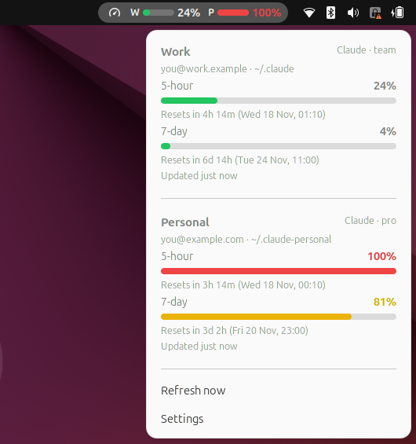

# AI Quota Meter

See how much of your Claude Code plan you have used, for every account you are logged into, without opening a terminal.



- Shows the 5-hour and weekly limits, with bars, percentages and when each one resets.
- Works with several accounts at once (for example `~/.claude` for work and `~/.claude-personal` for home).
- Remembers the last values, so they show up right after you log in, even offline.
- Codex (ChatGPT) accounts are supported experimentally.

Available as a GNOME Shell extension (Linux) and as a menu bar / system tray app (macOS, Windows).

## Install

### GNOME (Ubuntu, Fedora, …)

GNOME Shell 46 to 49. Install it from [extensions.gnome.org](https://extensions.gnome.org/), or from a release zip:

```bash
gnome-extensions install ai-quota-meter-gnome-v1.0.0.zip
```

Log out and back in, then turn it on in the Extensions app.

### macOS

1. Download `ai-quota-meter-macos-v…-universal.zip` from [Releases](https://github.com/Srabon444/ai-quota-meter/releases) and unzip it.
2. Move **AI Quota Meter.app** to Applications.
3. The app is not notarized. The first time, right-click it and choose **Open**.
4. When macOS asks to let it read the "Claude Code-credentials" keychain item, choose **Always Allow**. Claude Code keeps its login there on macOS.

### Windows

Download `ai-quota-meter-windows-v…-amd64.exe` (or `-arm64.exe`) from [Releases](https://github.com/Srabon444/ai-quota-meter/releases) and run it. The icon appears in the system tray; hover it to see usage, click or right-click it for details.

To start it with Windows, press `Win + R`, type `shell:startup`, and put a shortcut to the exe in that folder.

## Use

You need to be logged in to Claude Code (`claude`) at least once. Every folder in your home directory that holds a login is picked up automatically, whatever its name. If you use `CLAUDE_CONFIG_DIR` or `CODEX_HOME`, those are found too.

**GNOME:** click the meter in the top panel to see each account. Open **Settings** from the menu to:

- rename accounts and set the short label shown in the panel,
- hide an account, or keep it out of the panel,
- add a folder that was not found automatically,
- choose bar, text or both, and which limit the panel shows,
- set warning levels, notifications and a proxy.

**macOS / Windows:** the menu shows each account. **Open settings file** opens `config.json`:

```json
{
  "refresh_seconds": 300,
  "extra_folders": ["/Users/me/claude-work"],
  "labels": {"/Users/me/.claude": "Work"},
  "hidden": [],
  "proxy": ""
}
```

Changes apply on the next refresh or on **Refresh now**.

If the meter shows "Login expired", open Claude Code once. It refreshes the login and the meter updates within seconds.

## Privacy

- The login files (`.credentials.json`, `auth.json`, or the macOS keychain item) are only read, never changed.
- The token is sent only to the provider's own usage API: `api.anthropic.com` for Claude, `chatgpt.com` for Codex.
- Usage numbers and account emails are cached on your computer (`~/.cache/ai-quota-meter`, readable only by you). Tokens are not cached.
- No analytics, no other servers.

## Build from source

```bash
# GNOME extension zip -> dist/
scripts/pack-gnome.sh
gjs -m gnome/test/run.js

# macOS / Windows app (Go 1.23+)
cd desktop
go test ./...
go build -o ai-quota-meter .
./ai-quota-meter -check   # fetch every account once and print it
```

Every push builds all three versions in GitHub Actions. Pushing a tag such as `v1.0.1` (matching `VERSION`) publishes them as a release.

## Notes

- The usage endpoints are the ones Claude Code and Codex use themselves. They are not public APIs and may change.
- On macOS, logins for folders other than `~/.claude` are looked up by Claude Code's keychain naming; if one is not found, set `extra_folders` and log in there once.
- Not affiliated with Anthropic or OpenAI.

## License

GPL-2.0-or-later. See [LICENSE](LICENSE).
